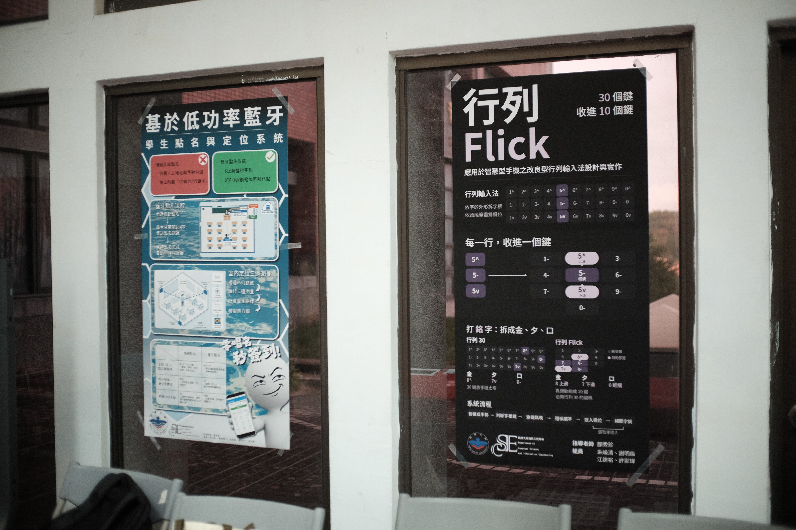
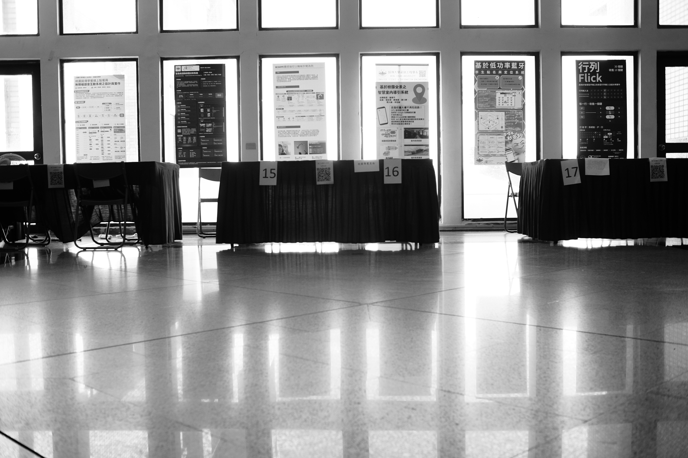
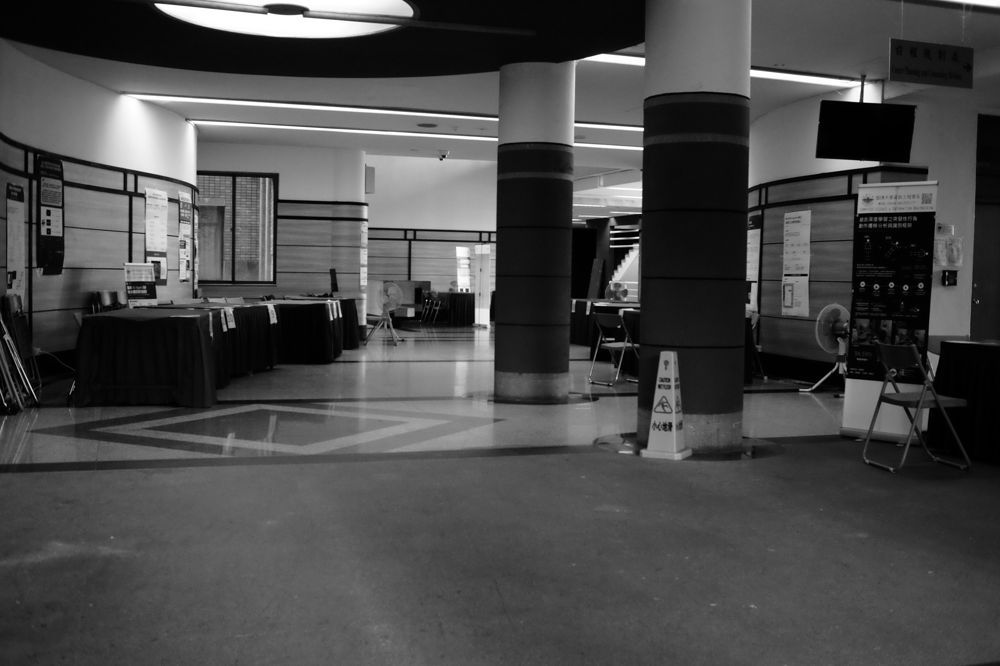

### 不情不願的組

別的組都在和自己組員聊天，但我覺得我和他們沒什麼好聊的。[還是會孤單](/posts/life/mcu-115-1/%E9%82%84%E6%98%AF%E6%9C%83%E5%AD%A4%E5%96%AE)

### 好相處的同學

我之前找不到組的時候，班長說他們五個人已達上限，今天發現他們加了另一個同學，變成六個人，不知是如何拜託系辦的。但我必須承認，**他比我好相處太多了**，又會搞很多 AI 工具。我自己都發現我不太合群。

### 拍照

雖然看別的組都比我們厲害，而且有點難過，但我覺得拍照還是我的使命，必須拍。後來和同學聊天時，他說「**我完全沒有發現你在拍。**」對我來說是我莫大肯定。因為想成為一個紀實攝影師，最重要的就是要讓自己隱形。

### 徐熊健老師的感想

「我看了八個組，每個都不知道自己在做什麼，還要當場翻 Source Code，原理還是我幫他們找出來的。你們做的東西阿貓阿狗都會做。天啊，這些人要怎麼找工作。」

哀，我覺得我自己也算阿貓阿狗吧。

\
\

